# GeekQuestAI

A self-playing pixel-art game for the GeekMagic 240x240 ESP8266 clock: a little technician runs an AI
data center on your desk, all by himself. You never press anything. He signs for deliveries, racks new
hardware, pulls the cables (you can watch them being laid), keeps the water plant and the rooftop
solar running, fights his robo-engineers when they go rogue, and sleeps on a cot in the office.

The only number on screen is **TLOPS**, top left: what the data center produces. It grows with every
rack he brings online and dips while something is broken. The rest of the top bar is the real weather
(icon and temperature for the place you choose) and the time. The bottom line shows, in turn, what he
is doing, the current goal, the clock's IP address, the date and the firmware version.

GeekQuestAI is the modern-day sister of [GeekQuest](https://github.com/techconcert/GeekQuest) and shares
its engine: the same recovery and update pages, WiFi setup, live weather, sleep schedule and flash saving.

**Download:** every build of the `main` branch is published on the
[Releases page](https://github.com/techconcert/GeekQuestAI/releases), named by number (**GeekQuestAI r1**, ...;
the number lives in the `VERSION` file). Each release has the two firmware files, `preview.html` (the game
in your browser) and `SHA256SUMS.txt`. Flash `SDP_GeekQuestAI_quest_*.bin` on the clock's update page
(`http://<clock IP>/update`). Coming from GeekQuest or the stock firmware, the first install is by hand.

## What the game looks like

Screenshots from the game core the clock runs, one per room.

| Server hall | Pulling a cable | Network room |
|---|---|---|
| 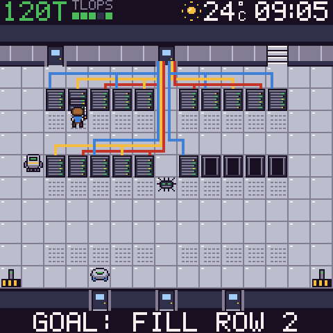 | 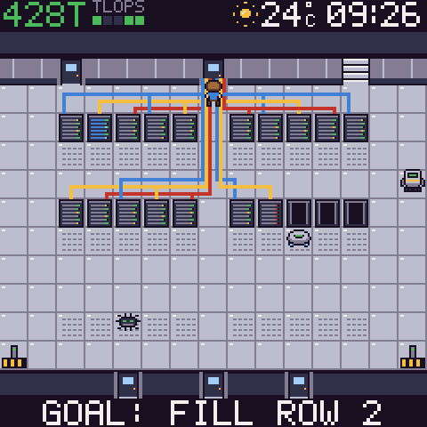 | 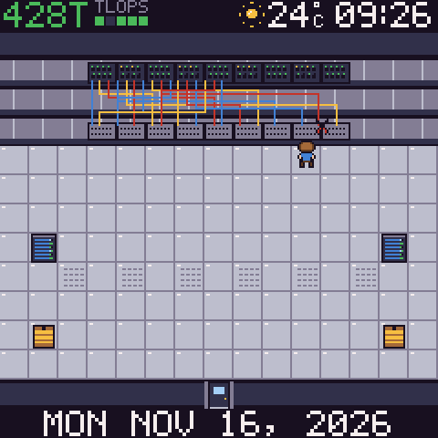 |

| Loading dock | Water plant (down) | Water plant (fixed) |
|---|---|---|
| 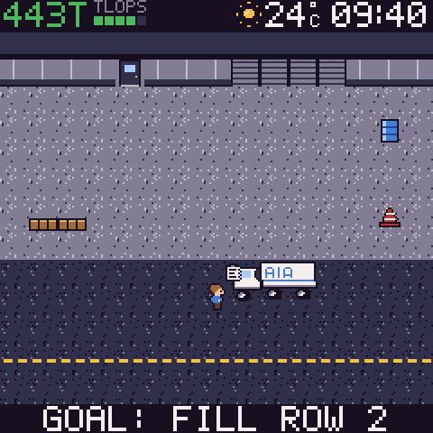 | 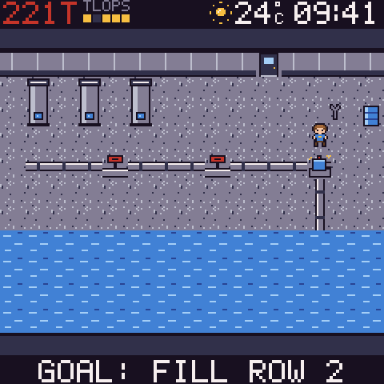 | 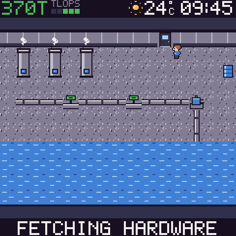 |

| Roof | Office | Asleep on the cot |
|---|---|---|
| 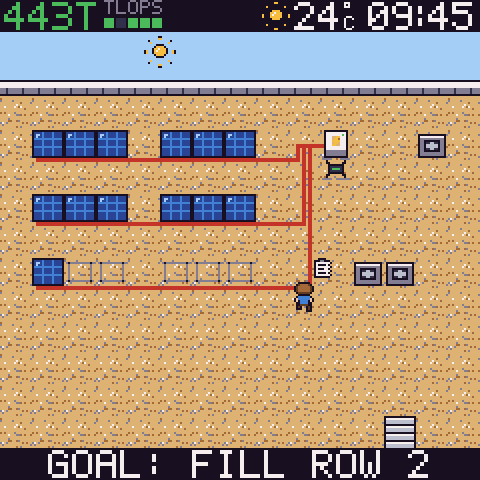 | 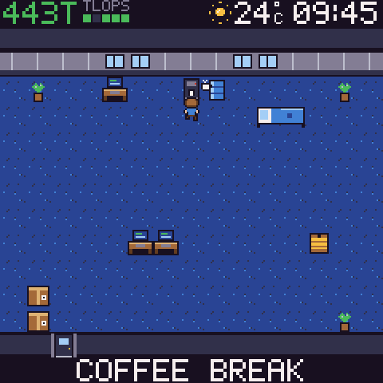 | 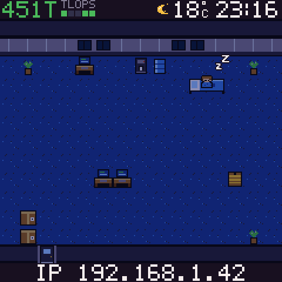 |

| Hardware store | At the checkout | A new game |
|---|---|---|
| 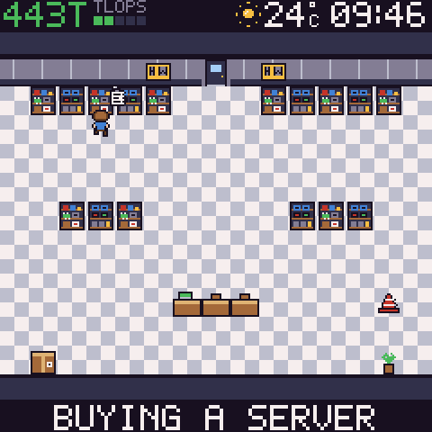 | 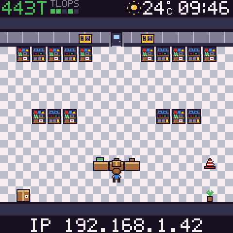 | 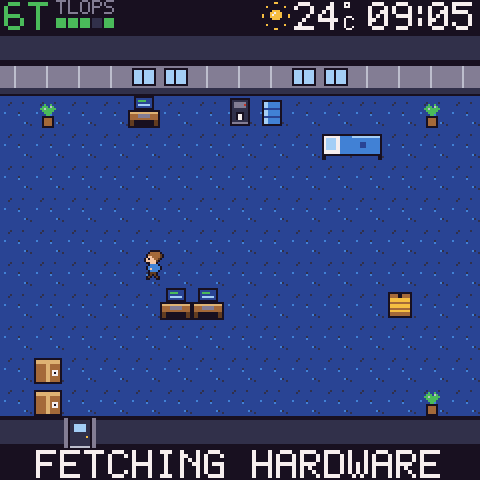 |

| Rogue robot | Info card |
|---|---|
| 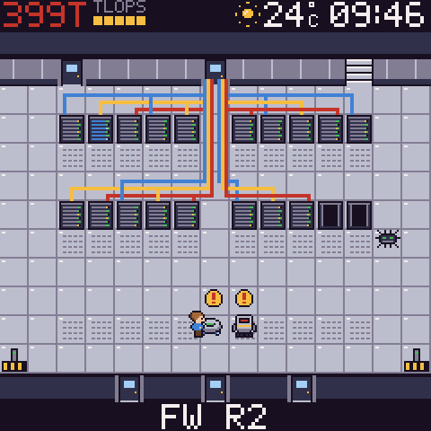 | 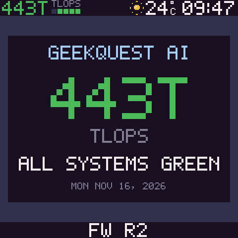 |

## How it plays

- **Building.** One or two trucks a day bring crates. A server crate becomes a new rack (or, once the
  hall of 30 racks is full, a GPU and then a liquid-cooling upgrade, then overclocking). A rack counts
  only when it is racked, wired to the network room door and patched. Solar crates become roof panels.
- **The hardware store.** Between jobs, from 08:00 to 19:00, he walks to the store off the server hall
  and buys cables, racks, servers, chips or a solar panel (it is all free). The goods go to the dock to be
  racked, the cables to the network room. Early on, when no server is waiting, he goes shopping for the
  next one himself.
- **A small start.** A new game begins with a single old server (6 T) and one crate on the dock; the
  number doubles once he has racked, wired and patched the second server.
- **Wiring you can see.** Every rack has its own blue, yellow or red cable in the trays above the rows;
  the trunk down the middle aisle and the weave in the network room grow with the hall.
- **Things break.** The water plant fails now and then: output halves until he has worked on the pump
  and both valves. Panels get dirty or crack (more in storms, wind and snow, from the live weather).
- **Robo-engineers.** A crate-bot, a sweeper and a cable-spider join as the hall grows, a drone on the
  roof. Now and then one goes rogue (red eyes): he chases it and knocks sense into it with a wrench.
  If he loses he naps on the cot for two minutes and the robot reboots itself.
- **One long mission a day**, 20 to 30 rooms rebuilt from a seed (nothing stored), roughly 30 to 50
  minutes; the bottom line shows for example `COOLING LOOP 9/22`. A mission survives a power cut.
- **Days differ.** Delivery times and loads, the mission, a small event (fire drill, broken coffee
  maker, power blip), weather wear on the panels: all come from the date.
- **Night.** He sleeps on the cot from 22:00 to 06:00, or by the sleep schedule you set on the clock's
  settings page; the data center keeps humming.

| Cooling Loop | Solar Build | Storm Repair | Fiber Hunt | Robot Uprising |
|---|---|---|---|---|
| 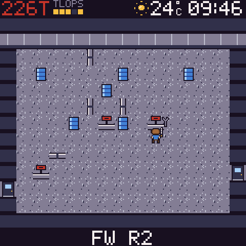 | 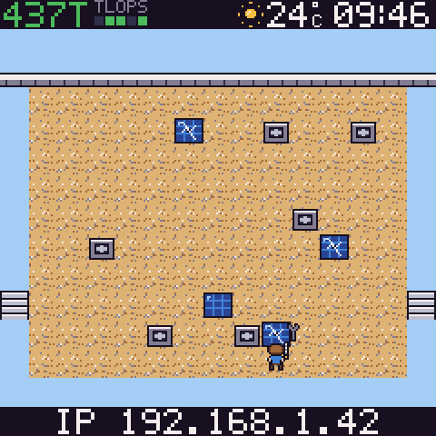 | 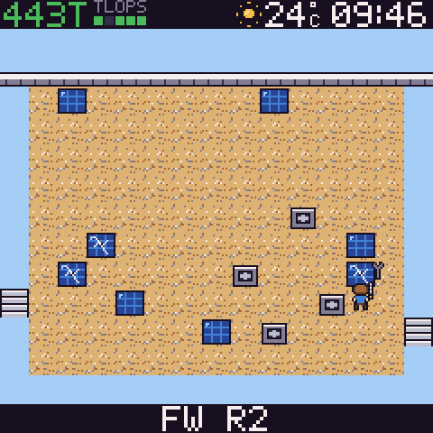 | 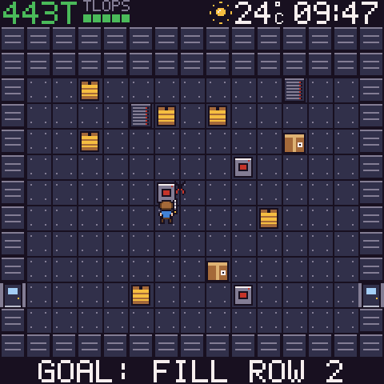 | 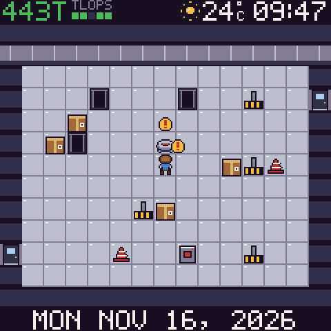 |

## Hardware

- GeekMagic SD Pro / SmallTV-style clock: ESP8266 (ESP-12, 4 MB flash) with a 240x240 ST7789
  display.
- Display wiring (from the [GeekMagic-Open-Firmware](https://github.com/Times-Z/GeekMagic-Open-Firmware)
  teardown): hardware SPI mode 3 at 40 MHz, MOSI 13, SCLK 14, DC 0, RST 2, CS tied to ground,
  backlight on GPIO 5 (active LOW).
- No serial adapter is needed or assumed. Everything is installed and recovered over WiFi.

## Builds

| File | What it is |
|---|---|
| `SDP_GeekQuestAI_quest_<version>.bin` | The game. |
| `SDP_GeekQuestAI_test_<version>.bin` | Display test: floor tiles, walking technician, RGB colour bars, FPS. Flash this first if you are unsure about colours. |

The names start with `SDP` because the stock updater only accepts such names.

## How to flash (over WiFi, no cable)

**First time, from the stock firmware:** open the clock's own web page, go to its firmware update
page and choose `SDP_GeekQuestAI_test_....bin` (or the game file, `..._quest_...`). Wait for the clock to restart.

**Later, from GeekQuest:** open `http://<clock IP>/update` (the IP address is on the clock's
bottom band and on your router's list), choose the new `.bin` and press **Upload and install**.
The page checks the file before uploading and shows its CRC32; the clock verifies the image again
before switching over. A failed or interrupted upload leaves the running firmware untouched.

Read [docs/RECOVERY.md](docs/RECOVERY.md) once, before the first install.

## The clock's web pages

Open `http://<clock IP>/`. The status page shows firmware, WiFi, network health, memory and
uptime. **Update firmware** and **Clock settings** are buttons in the first tile, **WiFi setup** is
in the Network tile.

**Update firmware** (`/update`): choose a `.bin` by hand, or press **Check for a new version**: your
browser (not the clock) asks GitHub for `latest.json` on the `builds` branch, tells you if a newer
build exists, and **Download it** loads the file into the page for you; you then press **Upload and
install**. The clock itself never talks to GitHub. The same checks run on the file as for a manual upload.

**Clock settings** (`/config`):

- **Weather:** search a city (foreign places work), or type latitude and longitude. Celsius is the
  default, Fahrenheit is an option. The clock asks [Open-Meteo](https://open-meteo.com/) (free, no
  account, plain HTTP) every 30 minutes and shows the icon and temperature on the top bar; the roof
  shows it (rain and snow fall there, storms and wind wear the solar panels).
- **Sleep:** a sleep time and a wake time. The technician walks to the office and lies down on the cot, the screen and
  game go dark, the CPU slows down, and the clock keeps the time. At the wake time everything
  comes back by itself with him up. **Sleep now** and **Wake now** buttons are there too.
  WiFi, the web pages and the update page stay on while asleep.
- **Location and time zone:** the city search also fills the time zone rule (converted in your
  browser, no firmware cost); you can still type the rule text by hand.
- **Screen:** brightness, colour depth, the weekly maintenance restart and the display test.
- **Save settings** and **Reset these settings** on this page touch only this page's settings.

The status page has a **Game settings** section (info card interval, quiet at night) with its own
Apply and **Reset game settings** buttons, which touch only those two settings.

**Settings and the game survive a power cut** (R5): see "Saving to flash" below.

## Recovery and the rescue hotspot

Every build contains, and CI refuses to produce a `.bin` without (`tools/check_bin.py`):

- **The update page starts first.** WiFi and the web server start before the display or the game,
  so a game bug cannot hide the update page.
- **Rescue hotspot** `GEEKQUEST-XXXX`, password `GEEKQUEST`, at `http://192.168.4.1/`. It is on for
  the first 10 minutes after every power-on and whenever the clock cannot find your WiFi. The
  WiFi page (`/wifi`) lets you enter your network again.
- **Crash-loop safe mode.** After 3 crashes in a row (or 5 in total without 6 hours of uptime in
  between) the clock boots without the game and shows SAFE MODE; after 6 it also skips the
  display. The update page still works.
- **Automatic restarts** (approved in R2): after hours without WiFi, with very low memory, and once
  a week at night. They never happen while a firmware upload is running, are rate limited, and
  count towards safe mode like any restart.
- **Size limit.** The ESP8266 holds the running firmware while receiving the next one, both inside
  a 1 MB area. CI fails any build over 500 KB, so updates always fit, including going back to
  stock.
- **Stock files are never touched.** Same flash layout as the stock firmware; the code never writes
  flash by itself (only the update page's Updater does), and CI forbids EEPROM, LittleFS and SPIFFS
  code. Flashing `SDPro_V1.0.6_....bin` from the GeekQuest update page brings the original clock
  back.
- **One flash area, approved by the owner.** Since R5 the clock saves its settings and the game in
  sectors 0x80000-0x82FFF (three 4 KB sectors, between the running image and a staged update).
  Nothing else is ever written: not 0x3FA000 (stock data), not 0xFF000, no EEPROM, LittleFS or
  SPIFFS. CI enforces this (`tools/lint_safety.py` rules L2 and L14). See "Saving to flash".

## Saving to flash

`firmware/store.cpp` keeps a ring log of 320-byte records (settings, weather and sleep settings, game)
in 36 slots over the three sectors. Each record has a CRC and a sequence number; the newest valid
one is loaded at boot, so a power cut in the middle of a write can never produce a half-saved state
(tested with random power cuts, see `test/test_slotlog.cpp`). Writes are rare: settings 5 seconds
after a change, the game every 20 minutes and at each new game day, at most 6 writes in 10 minutes;
every write is read back and 3 failures switch saving off. Nothing is written in safe mode, while a
firmware update runs, or when the image is larger than 0x7D000 bytes. After 2 or more crashes the
saved game is kept aside, not loaded, so a game that crashes the clock cannot crash it again from
the save. Updating to a new GeekQuestAI build keeps everything (a GeekQuest save is not carried over, the settings are); flashing the stock firmware does not
(not needed). The status page shows "Saved to flash ..." or "Loaded from flash ..." lines.

Gates: `tools/lint_safety.py`, `tools/check_bin_selftest.py`, `tools/check_bin.py` on every `.bin`,
a size report, and `tools/recovery_guard.py` (a `RECOVERY-CHANGE:` commit line and a new
`GQ_RECOVERY_REV` whenever a recovery file changes).

## Build and test

Firmware (PlatformIO, ESP8266 Arduino core):

```
pio run -e quest        # the game  -> dist/SDP_GeekQuestAI_quest_<version>.bin
pio run -e test         # display test build (the only one with the test scene)
```

Host tests (no ESP8266 needed; run every `test/*.cpp`; `test_dc` simulates six weeks and takes a few minutes):

```
for t in test/*.cpp; do
  g++ -std=c++17 -O1 -g -fsanitize=address,undefined -fno-sanitize-recover=all -Wall -Wextra -Werror \
    -o /tmp/$(basename $t .cpp) $t lib/gamecore/src/*.cpp lib/gqsafe/src/*.cpp && /tmp/$(basename $t .cpp)
done
python3 tools/lint_safety.py && python3 tools/lint_safety.py --selftest
python3 tools/check_bin_selftest.py
```

Browser preview (clang with wasm32 and lld): `tools/build_preview.sh` writes `preview/dist/index.html`.
The preview is the same game core as the clock, plus a debug panel that is not in the firmware: speed
up time, set the live weather and sleep mode, call a delivery truck, break the water plant, make a robot
go rogue, **start any mission**, add racks and panels, or put the technician in any room.
`tools/shots.cpp` renders the README screenshots from the same core.

Art: tiles and sprites are `assets/src/*.png` on a 16x16 grid with the 16-colour palette in
`tools/palette.py`. They are painted by `tools/paint_dc.py` (the technician and the weather icons come from
the GeekQuest sheets in `assets/base/`). After editing run `python tools/paint_dc.py && python tools/png2tiles.py`.

## Repository layout

```
firmware/        ESP8266 entry (main.cpp), ST7789 driver, recovery layer (safety.cpp, netwatch.cpp), prefs.cpp,
                 weather (wxnet.cpp), sleep schedule (nightmode.cpp), settings page (config.cpp)
lib/gamecore/    portable game core (no heap, no libc), used by the firmware and the preview
lib/gqsafe/      pure decision code of the recovery layer (boot counters, WiFi ladder, upload checks)
assets/src/      editable PNG sheets
tools/           asset converter, version stamp, .bin safety checks, source lint, CI guards
firmware/config_page.h  source of the /config page; the firmware serves the gzip copy in config_page_gz.h (run tools/gen_config_gz.py after editing it, CI verifies)
docs/            the owner's recovery guide, screenshots
preview/         browser preview (WebAssembly)
test/            host tests
```

## How it draws

No full framebuffer (115 KB would not fit). The screen is 15 strips of 240x16 pixels; only strips
that changed are redrawn and sent. Art is stored as 4-bit indexed tiles in flash and expanded
through a 16-colour palette, which also makes the day/night tints cheap.

## License

Public domain: [CC0 1.0 Universal](LICENSE). No rights reserved.
